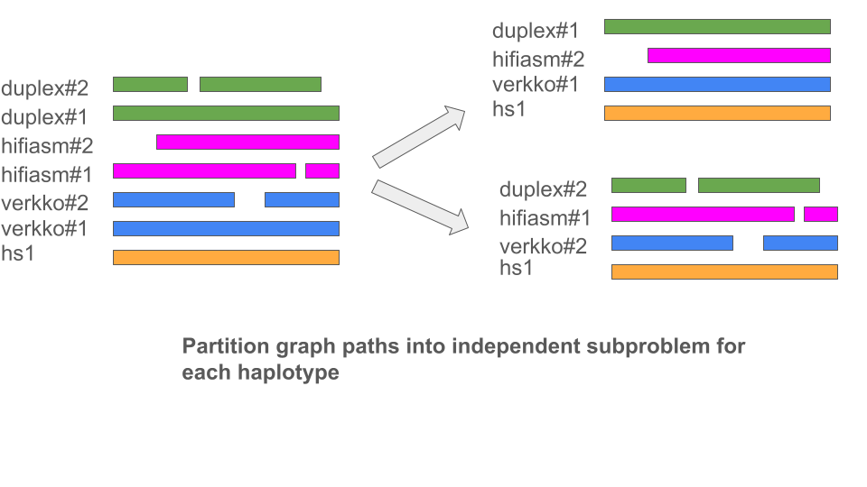
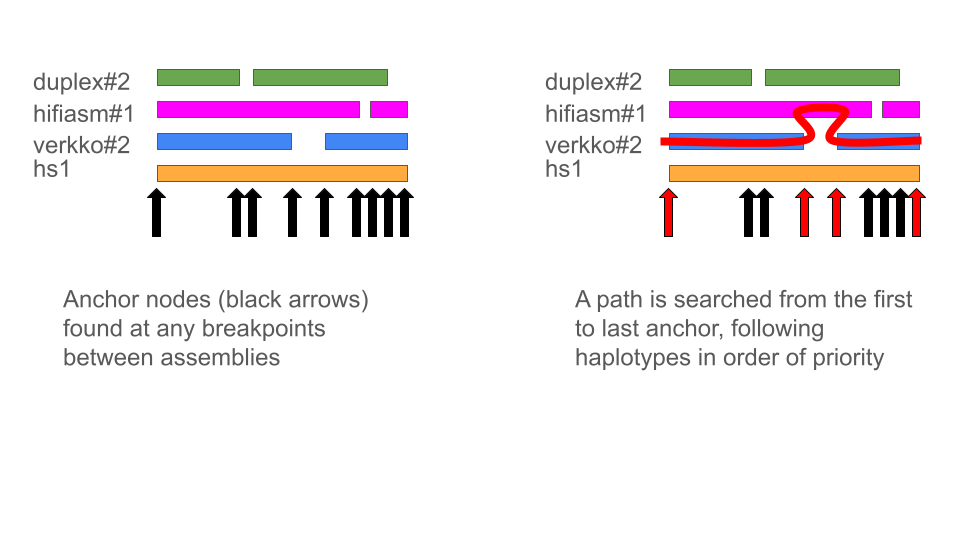

# panpatch

Use a pangenome graph to patch (slightly) fragmented assemblies into telomere-to-telomere (T2T) chromosomes. Taking the patch sequence from one or more donor assemblies, panpatch:

- fills gaps (`N`s) inside scaffolds,
- scaffolds disconnected contigs,
- completes missing terminal telomeres, and
- with `--error-bed`, replaces regions that QC flagged as assembly errors.

Gap filling, scaffolding and telomere completion are on by default; `--patch-types` selects a subset and `-T` additionally requires a telomere at both ends. Every candidate patch is a row in a report, with the reason when it is rejected.

It needs a **reference** with chromosome-scale scaffolds for orientation (`-r`), a **target** to patch (first `-s`), and one or more **donors** in priority order (subsequent `-s`). A chromosome-scale target can be its own reference.

> [!IMPORTANT]
> **The recommended way to run panpatch is [`cactus-panpatch`](https://github.com/ComparativeGenomicsToolkit/cactus/blob/master/doc/pangenome.md#patching-assemblies-cactus-panpatch)**, now included in [Cactus](https://github.com/ComparativeGenomicsToolkit/cactus). It is a higher-level interface that builds the pangenome graph and runs panpatch for you in a single command — much simpler than the manual workflow below.

## Quick start

**1. Build a pangenome graph** of your assemblies with [Minigraph-Cactus](https://github.com/ComparativeGenomicsToolkit/cactus/blob/master/doc/pangenome.md). The `--reference` and `--chrom-vg full` options are required. List the assemblies in a seqfile (the `.1`/`.2` suffix sets the [haplotype](https://github.com/ComparativeGenomicsToolkit/cactus/blob/master/doc/pangenome.md#sample-names)):

```
hs1               https://hgdownload.soe.ucsc.edu/goldenPath/hs1/bigZips/hs1.fa.gz
PAN028-verkko.1   PAN028.hap1.verkko.fa
PAN028-verkko.2   PAN028.hap2.verkko.fa
PAN028-hifiasm.1  PAN028.hifiasm.hap1.fa
PAN028-hifiasm.2  PAN028.hifiasm.hap2.fa
```
```
cactus-pangenome ./js seqfile.txt --reference hs1 --chrom-vg full --outName mc --outDir mc   # + cluster options
```

**2. Run panpatch** over all the chromosome graphs in one command:
```
cd mc/mc.chroms
panpatch *.full.vg -r hs1 -s PAN028-verkko -s PAN028-hifiasm --bed patched.bed -f patched.fa > patched.report
```

This patches `PAN028-verkko`, using `PAN028-hifiasm` (and any later `-s` as backups), and writes three independent outputs:

- **`patched.report`** (stdout) — a TSV, one row per candidate patch (see [The report](#the-report));
- **`patched.bed`** — the patched-assembly intervals;
- **`patched.hap1.fa` / `patched.hap2.fa`** — one FASTA per target haplotype.

A chromosome that can't be patched keeps its input contig(s). The BED and FASTAs are written only after every graph succeeds, so a failure never leaves partial output. Add `-p` for progress on stderr.

You can pass one graph or many (`panpatch chr*.full.vg ...`); they are processed in sorted order of file name and their outputs concatenated. A graph without exactly one reference path (e.g. a `chrOther` bin of unplaced contigs) has its target contigs passed through unchanged, and a graph with no target contigs is skipped.

## Reference-free patching

panpatch can run with **no external reference** by using the target haplotype as its own reference — the donor then aligns directly to the target instead of through a third genome. Minigraph-Cactus references must be haploid, so build **one graph per haplotype** and pass that haplotype as both `-r` and the first `-s`. For `PAN028-verkko` haplotype 1, the seqfile drops the external reference and the other haplotype:

```
PAN028-verkko_1   PAN028.hap1.verkko.fa
PAN028-hifiasm.1  PAN028.hifiasm.hap1.fa
PAN028-hifiasm.2  PAN028.hifiasm.hap2.fa
```
```
cactus-pangenome ./js seqfile.txt --reference PAN028-verkko_1 --chrom-vg full --outName mc1 --outDir mc1
panpatch mc1/mc1.chroms/*.full.vg -r PAN028-verkko_1 -s PAN028-verkko_1 -s PAN028-hifiasm \
    --bed patched_1.bed -f patched_1.fa > patched_1.report
```

The target is haploid in this graph (haplotype 0), so its FASTA is `patched_1.hap0.fa`. Repeat with `_2` for haplotype 2. Here the graph's "chromosomes" are the assembly's own contigs, so panpatch fills gaps and completes telomeres within each contig but cannot scaffold across them.

## Building

```
git clone --recursive https://github.com/glennhickey/panpatch.git
cd panpatch && make
```

Missing system libraries are a subset of [vg's](https://github.com/vgteam/vg?tab=readme-ov-file#linux-install-dependencies). Prebuilt Linux binaries are on the [releases](https://github.com/glennhickey/panpatch/releases) page.

## Options

Inputs and outputs:

| option | description | default |
|---|---|---|
| `-r, --reference STR` | reference sample (required) | |
| `-s, --sample STR` | target to patch (first), then donors in priority order (required, repeatable) | |
| `-f, --fasta FILE` | write the patched assembly, one FASTA per target haplotype (`FILE.hap1.fa`, ...) | |
| `--bed FILE` | write the patched-assembly intervals (BED) | |
| `-e, --default-sample STR` | when a patch fails, write this sample's contig instead of the target's (only where it has exactly one contig on the chromosome; a diploid sample's haplotypes must be consistent with the target's) | |
| `-p, --progress` | print progress to stderr | |
| `-t, --threads N` | threads | all |

`--bed` and `-f` files are written atomically, only on full success. The report always goes to stdout.

What to patch:

| option | description | default |
|---|---|---|
| `--patch-types LIST` | which of `{gap,telomere}` to attempt, comma-separated (scaffolding is always attempted) | `gap,telomere` |
| `-T, --require-telomeres` | require a telomere at both ends, else revert (see [Telomeres](#telomeres)); cannot be combined with a `--patch-types` that leaves out `telomere` | off |
| `--error-bed FILE` | assembly-error intervals on any input assembly, contigs named `SAMPLE#HAP#CONTIG` (see [Error regions](#error-regions)) | |
| `-b, --exclude-bed FILE` | target regions to leave untouched (see [Excluding regions](#excluding-regions)) | |
| `-w, --window N` | window size (bp) for the identity used to match donor haplotypes to the target's | 1000 |

Contig ends (see [Telomeres](#telomeres)):

| option | description | default |
|---|---|---|
| `-M, --max-telomere-patch N` | max bp of target sequence a telomere graft or a tip graft may replace at a contig end (0: none, so a graft may only add sequence at the tip) | 20000 |
| `--max-subtelomere-graft N` | max bp of donor sequence a telomere graft may carry ahead of the donor's telomere, and a tip graft may add beyond the bp it replaces (0 disables) | 2000 |
| `--telomere-threshold F` | min telomere hexamer density to call a telomere | 0.8 |
| `--telomere-report FILE` | standalone: print the per-contig telomere status (`#Contig` lines) of a finished FASTA and exit | |

Patch checks (see [Why a patch is rejected](#why-a-patch-is-rejected)):

| option | description | default |
|---|---|---|
| `--min-cover F` | revert a patch shorter than this fraction of the target contigs it is made from | 0.95 |
| `--graft-recovery F` | reject an interior graft whose sequence shares less than this % of the k-mers it replaces | 50 |
| `--graft-min-bp N` | apply `--graft-recovery` only when at least this many non-N bp are replaced; a smaller graft (e.g. an N-gap fill) is judged by `--min-flank` | 10000 |
| `--min-flank F` | reject such a graft, or a donor bridge between two target contigs, whose donor shares less than this % of the target's flank on either side | 50 |
| `--flank-window N` | window (bp) each side over which flank anchoring is measured | 500000 |
| `--max-graft-size-change N` | reject an interior graft that makes its contig more than N bp longer or shorter (0 disables) | 100000 |
| `--min-graft-complexity F` | reject an interior graft that replaces or inserts sequence whose distinct k-mer fraction is below F, over all of it or in any `--graft-complexity-window` (0 disables) | 0.5 |
| `--graft-complexity-window N` | window (bp) in which `--min-graft-complexity` is also measured, so a satellite array inside a larger graft is not diluted (0: whole graft only) | 10000 |
| `--graft-complexity-min-bp N` | apply `--min-graft-complexity` only when at least this many non-N bp are replaced or inserted | 2000 |
| `--max-swap-size-change N` | excise a swap (a graft over sequence with no `N` gap, or an insertion) that changes its contig's length by more than N; gap fills are held to `--max-graft-size-change` only (0 disables) | 10000 |
| `--max-graft-pieces N` | excise a graft (interior, tip, or scaffold bridge) spliced from more than N pieces of donor sequence (0 disables) | 1 |

## The report

The stdout report is a TSV with one row per candidate patch:

```
chrom  hap  type      target              target_bp  donor       donor_bp   replaced_bp  kmer%  flankL%  flankR%  decision  reason                                               target_start  target_end
chr12  2    gap-fill  haplotype2-0000064  132285855  CM088792.1  133100000  1175239      98.4   100.0    100.0    accepted  .                                                    63000000      64175239
chr14  1    gap-fill  haplotype1-0000004  101799395  CM090131.1  101948476  197297       0.4    98.1     100.0    rejected  k-mer recovery 0.4% < 50.0% (repeat-region misjoin)  101051458     101248755
```

(Shown aligned and with contig names shortened; the real output is tab-separated and uses full path names.)

- `type` is `gap-fill` (a donor graft inside a contig, or a [tip graft](#tip-grafts)), `telomere` (a telomere graft), `scaffold` (a join of two target contigs; `donor` is the bridging donor, or the second contig when they are joined directly) or `passthrough` (a target contig written out unchanged, because it is not part of the patched contig or its graph has no reference chromosome).
- `replaced_bp` is the target sequence replaced, and `target_start`/`target_end` its place on the target contig.
- `kmer%` is the percent of the replaced sequence's k-mers found in the graft (content); `flankL%`/`flankR%` are how much of the target's flank each side the donor shares (locus).
- `decision` is `accepted` or `rejected`, with the cause in `reason`. When a whole contig reverts, every patch accepted on it becomes `rejected` with `contig reverted: <cause>`.
- An `N` gap that is still in a patched contig, with no other row about it, gets a rejected `gap-fill` row of its own (`no donor could be threaded across this gap; kept as it is`, with the gap's place). A contig with gaps and no patch at all gets one row, `no patches from other assemblies were found; contig kept as it is`.
- A value that does not apply is `.`.

A contig that needs no patch has no row. After each haplotype's rows comes a `#Contig` line for every sequence written, with its length and whether each end has a telomere (and the hexamer density measured there):

```
#Contig NAME len=<N>bp left=YES|NO(<density>) right=YES|NO(<density>)
```

These numbers let you scrutinise borderline calls and retune the checks.

The `--bed` file lists, in order, the contig intervals (path, start, end, strand) that make up each output sequence:

```
#Patched assembly on chr8 for PAN028-verkko#1:
PAN028-hifiasm#2#h2tg000032l#0	2	27	+
PAN028-verkko#1#haplotype1-0000008#0	0	64821530	+
```

A patched sequence is named `<chrom>_hap_<N>` in the FASTA. A reverted or passed-through contig keeps its own name, under a `#Unpatched (input contig)`, `#Default sample contig` or `#Passthrough` header in the BED.

## Telomeres

Telomere completion is **on by default**; `--patch-types gap` turns it off (and `--patch-types telomere` turns gap filling off). If the target stops short of a telomere at an end, panpatch splices on a donor that does reach one. The handoff is made at the nearest graph node both assemblies share, so the target's tail past that node is replaced by the donor's run to its telomere. Each graft is a `telomere` row in the report.

Telomere grafts are kept small, because a telomere is missing from an assembly for a reason: reads represent it poorly, so neither the assembler nor read-based QC can vouch for much sequence at a contig end.

- `-M/--max-telomere-patch` caps how much target sequence a graft may replace. If the nearest usable handoff is further in, the end is left as it is.
- `--max-subtelomere-graft` caps how much donor sequence a graft may carry ahead of the donor's telomere array. A donor over the cap is skipped for the next one.
- A donor whose run to its telomere contains an `N` or one of its own `--error-bed` intervals is skipped in the same way.

A telomere graft therefore repairs or supplies the array (typically by trimming a short capless tail off the target and taking the donor's telomere), and does not bring in a subtelomere the target lacks. A donor skipped for one of these reasons is reported as a rejected row if no other donor completes the end.

A contig whose end can't be completed is **kept** as it is, with its other patches. `-T/--require-telomeres` makes this strict: each patched sequence must begin and end with a telomere (density ≥ `--telomere-threshold`), and one that doesn't reverts to its input. With `-T`, an end left uncapped is also reported, as having no donor that reaches a telomere or as a telomere that is present but buried or degraded.

Two checks apply with or without `-T`: a patch may never trim off an end of a target contig that already has a telomere, and (while telomere patching is on) a patched sequence with an internal telomere, the sign of a scaffold misjoin, reverts.

`--telomere-report FILE` prints the same `#Contig` lines as the report for any FASTA (plain or gzipped) and exits; it needs no graph, `-r` or `-s`. Use it to measure an assembly that was processed further after panpatch ran.

### Tip grafts

Where the target cannot reach one of its ends (an `N` gap or a flagged region near the tip) and a donor carries the patch out past the target's outermost piece, nothing anchors the far end of the graft. Such a tip graft is held to a telomere graft's limits:

- it may replace at most `--max-telomere-patch` bp of the target's end;
- it may add at most `--max-subtelomere-graft` bp more than it replaces;
- it may not take off a telomere the target has;
- it must be one piece of donor sequence (`--max-graft-pieces`).

One that fails is dropped and the target keeps its own end. The donor's end is taken only up to its first `N` or `--error-bed` interval, and no telomere graft is made on top of it. Tip grafts are gap filling: they are `gap-fill` rows in the report, and `--patch-types telomere` leaves them out.

## Error regions

`--error-bed FILE` lists intervals that QC flagged as assembly errors, on the target or on any donor. panpatch replaces the target's flagged sequence with a donor's where it can, and never uses a donor's.

The graph must be built from the assemblies as they are, not with the flagged regions masked to `N`. A donor that agrees with a flagged stretch of the target then shares its nodes, and a patch differs from the target only where the donor does.

- **Contig names** are those of the graph: `SAMPLE#HAP#CONTIG` (`HAP` is 0 for a haploid sample), or a full path name. Coordinates are on the whole contig; where the graph holds only a subrange of it, they are shifted to match. A sample that is in no input graph gets a warning.
- **On the target**, a flagged region is replaced where a donor can thread across it, and kept where none can. The target takes over again at the last node it shares with the donor, so the swap ends with the flagged region.
- **On a donor**, flagged sequence never goes into a patch: not in a gap fill or scaffold bridge, and not in a telomere or tip graft.
- A flag is on a path, not a node: where the target's flagged sequence is aligned to a donor's unflagged copy, the donor's can be used.
- A donor that spells exactly the sequence it would replace is reported as rejected, `nothing to patch`.
- A replacement is checked like any other graft (see [Why a patch is rejected](#why-a-patch-is-rejected)), and one that runs off the end of the target is a [tip graft](#tip-grafts).

## Excluding regions

`-b/--exclude-bed FILE` lists target regions panpatch must leave untouched (it keeps the original target sequence there, never substituting a donor). Coordinates are in the first `-s` sample, and the first column is the full target-contig path name as it appears in panpatch output. This is handy for acrocentric rDNA-adjacent gaps that would otherwise be overfilled:

```
echo -e "PAN027-verkko-1#0#PAN027.chr22.paternal\t11000000\t13000000" > exclude.bed
panpatch chr22.full.vg -r PAN027-verkko-1 -s PAN027-verkko-1 -s PAN027-herro -b exclude.bed
```

## Why a patch is rejected

panpatch errs on the side of leaving the target as it is. A patch that fails a check is either dropped on its own, the rest of the contig's patches being kept, or reverts the whole contig to the target's input contig(s) (or `--default-sample`'s). Either way it is a report row with `decision` `rejected` and the cause in `reason`.

**A patch dropped on its own**

A donor's `N`s and `--error-bed` intervals are never used: a donor is not threaded across them, and only the target is, keeping its own gap or flagged sequence where no donor can replace it.

An interior graft, a donor run between two pieces of the same target contig, is excised and the target's own sequence restored if it is:

- **A misjoin by content** — it replaces ≥ `--graft-min-bp` non-N bp and its sequence shares < `--graft-recovery` % of their k-mers.
- **A misjoin by locus** — it replaces less than that (an N-gap fill, say) and its donor shares < `--min-flank` % of the target's flank, within `--flank-window`, on either side.
- **Unverifiable by size** — it changes the contig's length by more than `--max-graft-size-change` (a satellite array or rDNA gap swapped for the donor's).
- **Swap changing the length** — a graft over sequence with no `N` gap (or a pure insertion) that changes the contig's length by more than `--max-swap-size-change`: a copy-number change in an array or a tandem duplication, which k-mer recovery cannot check. An `N` gap's length is only a placeholder, so gap fills are not held to it.
- **Spliced from several donor pieces** — the graft is more than `--max-graft-pieces` pieces of donor sequence: pieces of two donor contigs, or of one contig on both strands or out of its order. Each piece is anchored where it switches, so the tests above can pass, but the graft spells sequence that no donor has in one piece. On the HPRC pilot such grafts were the largest length changes in a recipe's swaps (+44 kb, +27 kb, −19 kb, +13 kb), in pericentromeric segmental duplications. A scaffold bridge of several pieces reverts the scaffold.
- **Unverifiable by content** — it replaces or inserts ≥ `--graft-complexity-min-bp` of low-complexity sequence: a distinct k-mer fraction < `--min-graft-complexity` over all of it, or in any `--graft-complexity-window`, so an array inside a larger graft is caught. Any tandem array of the same satellite family shares its k-mers, so k-mer recovery cannot tell a faithful copy from a different one.
- **Identical** — the donor spells exactly the sequence it replaces: `nothing to patch`.
- **Not asked for** — gap filling is turned off by `--patch-types`.

At a contig end:

- **Tip graft** — one over its [limits](#tip-grafts) is dropped, and the target keeps its own end.
- **Telomere graft** — one that would replace more than `--max-telomere-patch` of the target, carry more than `--max-subtelomere-graft` ahead of the donor's telomere, or take in a donor's `N`s or flagged sequence is not made (see [Telomeres](#telomeres)). Where both ends' grafts would cross on a short contig, neither is made.

**The whole contig reverts**

- **Too short** — the patch is shorter than `--min-cover` of the target contigs it is made from.
- **Same-sample interior splice** — one of the target's own spare fragments is stitched into the middle of a contig that already spans the region (a repeat-region misjoin).
- **Low k-mer recovery** — the donor sequence still inside a target contig, taken together, fails `--graft-recovery`; a backstop for grafts the excision above does not handle.
- **Wrong-locus scaffold bridge** — a donor bridging two target contigs shares < `--min-flank` % of either contig's flank.
- **Discarded telomere** — the patch trims off an end of a target contig that has a telomere, however little it trims.
- **Sequence written twice or out of order** — a final check: the patch uses a stretch of a path twice, uses a target contig on both strands or out of its own order, or puts donor sequence where a target contig it does not use (and which is written out as it is) already has it.
- **Internal telomere** (unless `--patch-types gap`) — a telomeric run of 1 kb or more lies at a scaffold join: either contig's end there, or the donor bridge between them.
- **With `-T`: a missing telomere** — the patched sequence does not begin and end with a telomere, e.g. because the only graft for an end is too large.

A target that shares too few anchors with the reference to be threaded is also left as it is, as is a contig with gaps that no donor can patch; each gets a row saying so.

Quality control is heuristic — these checks catch the common misjoins, but there is no full alignment-based scoring of a patch.

## Algorithm

All contigs are first binned by haplotype (the input need not be trio-phased) using average alignment identity in the graph over `-w` windows, so e.g. verkko's haplotype 1 is matched to the right hifiasm haplotype.



The reference path is then scanned left-to-right for *anchors* — nodes where an assembly path starts, ends, or branches — and a path is threaded through them from the first to the last anchor, staying on the highest-priority assembly at each junction. That path is the patched, ideally T2T, contig.



The threading is conservative about donors. A donor is followed only on the strand the reference runs and only forwards: it stops at an anchor that is behind it or that it crosses in the opposite direction to the reference (an inversion). A path is not taken up at a node it visits more than once. A donor is never followed across its `N`s or its `--error-bed` intervals, while the target is, when no donor gets past them.

The threaded path is then checked in stages (see [Why a patch is rejected](#why-a-patch-is-rejected)): tip grafts are limited, missing telomeres grafted on, bad interior grafts excised, and the result checked as a whole.

Running time: `cactus-pangenome` takes a couple of hours on a cluster; the single `panpatch` command over all chromosome graphs takes ~2 minutes on a desktop.

**Limitations:** entirely reference-based (no anchors are found where the graph doesn't align contigs to the reference, e.g. some acrocentric short arms); the left-to-right search is simple and some cases would benefit from a more general graph search.

## Citation

If you use panpatch, please cite:

> Cechova M, Potapova TA, Rechtsteiner A, Hickey G, *et al.* Complete genomes of a multi-generational pedigree to expand studies of genetic and epigenetic inheritance. *bioRxiv* (2025). [doi:10.64898/2025.12.14.693655](https://doi.org/10.64898/2025.12.14.693655)
